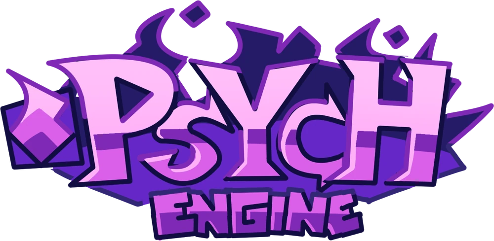

# 🌌 OUTER!ENGINE

  <strong>A cosmic modding engine built around creativity, customization, and the OUTER! universe.</strong> 
  <em>Powered by HaxeFlixel. Shaped by MinusBright.</em>

  

> **Project status:** work in progress. OUTER!ENGINE is based on Psych Engine code, with its own direction, tools, and cosmic identity. Some systems are experimental and may need build validation.

## ✨ The OUTER!ENGINE vision

OUTER!ENGINE aims to make Friday Night Funkin' modding feel like exploring a galaxy of possibilities, without throwing away the flexibility of a source-based engine.

- **Cosmic interface:** a deep-space palette, violet energy, drifting stars, and a distinctive OUTER! presentation.
- **Modding-first foundations:** build on the existing HaxeFlixel/Psych codebase instead of pretending the project started from zero.
- **Assistant scheduling:** configurable assistant shifts, per-assistant hours, weekday rules, presets, and an optional global switch.
- **Performance tools:** frame-time telemetry, configurable FPS caps, and experimental adaptive-quality controls.
- **Extensible direction:** keep existing gameplay, Lua/HScript support, and familiar modding workflows wherever possible.

## 🤖 Assistant schedules

The schedule system is designed to let developers configure when each assistant is active.

- Per-assistant start time and shift duration.
- Day-of-week profiles and ready-made schedule presets.
- Optional global enable/disable control.
- ENGINE, BACKGROUND, and BOTH execution modes.
- A shared outer_assistant_schedule.json configuration for the game and the optional background scheduler.

The standalone scheduler currently calculates availability and exposes local status endpoints. **Connecting an assistant to Discord or another external provider requires a provider adapter and is not included in the scheduler worker itself.**

See [Assistant Scheduler documentation](docs/ASSISTANT_SCHEDULER.md).

## 🚀 Performance and frame pacing

The performance tools track frame time, average and worst frame time, hitch counts, and estimated dropped frames. FPS caps and quality profiles can be configured, while the adaptive profile can lower or restore optional visual quality based on sustained frame pacing.

These controls are a foundation, not a promise that every mod will run faster. Heavy Lua/HScript logic, shaders, video playback, and asset loading can still affect performance.

## 🛠️ Building from source

OUTER!ENGINE uses the HaxeFlixel/Lime toolchain inherited from its upstream codebase. Start with the repository's build instructions:

- [Build instructions](docs/BUILDING.md)
- [Assistant scheduler setup](docs/ASSISTANT_SCHEDULER.md)

Use the versions of Haxe, HaxeFlixel, Lime, and other libraries expected by this checkout. Because the project is actively changing, compile the current branch before treating it as a stable release.

## 🪐 The cosmic crew

- **MinusBright:** the OUTER!ENGINE assistant and cosmic guide.
- **PlusVoid:** the black-hole brother who would probably rather compile Haxe to C++ and take a nap.

Assistant personalities and lore are part of the project's own identity; they do not replace credits for the engine's existing code.

## 🧩 Upstream foundation and credits

OUTER!ENGINE builds on code from **Psych Engine** and its wider open-source ecosystem. The project retains the applicable upstream licenses and attribution for code and assets it uses. This README is an OUTER!ENGINE project overview, not a claim of sole authorship of the underlying engine.

Please consult the repository's license and the upstream project's own credits for the original contributors and third-party libraries.

## 📌 Current development

This project is under active development. Features may be incomplete, experimental, or awaiting compilation and runtime testing. Please report reproducible bugs with your operating system, build target, and the exact steps that trigger the issue.

---

  OUTER!ENGINE • Beyond the familiar. Into the OUTER.

